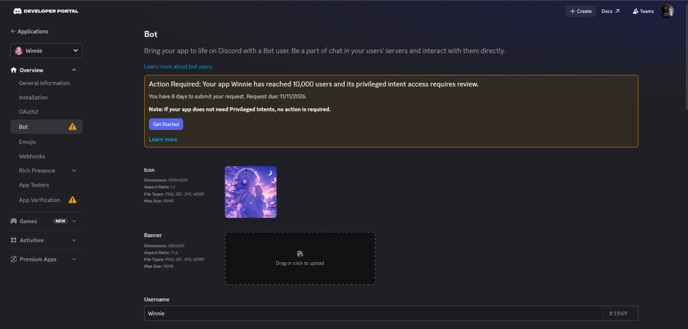

# Winnie — Discord music bot

[🇧🇷 Português](README.pt-BR.md) · 🇺🇸 English

A Discord music bot (discord.js v14) with slash commands, queue, lyrics, 20+ languages and sharding support for large numbers of servers.

> **Code origin:** this project is based on an open-source music bot by [umutxyp](https://github.com/umutxyp), licensed under MIT (see `LICENSE`).
> I adapted the bot, deployed it and keep it running in production.

## In production

The bot is used in real servers on Discord. The Discord Developer Portal itself reports that the app **Winnie** (ID `891783462615400528`) reached **10,000 users**, which requires a review to keep using privileged intents:



## Features
- Play music by search or link (YouTube, Spotify, SoundCloud, direct link)
- Queue, button controls, lyrics via Genius
- 20+ languages
- Sharding (`shard.js`) to scale beyond 1,000 servers

## Getting started
```bash
npm install
cp .env.example .env     # fill in your own tokens
npm start                # or: npm run shard
```
Requires Node 24+ and an application created at https://discord.com/developers/applications.

## Security
Tokens live only in `.env` (ignored by git). Never commit `.env` or `cookies.txt`.

## License
MIT. Original copyright by umutxyp, kept in `LICENSE`.
