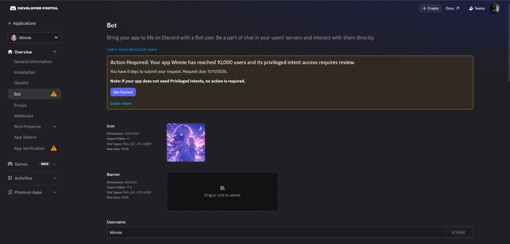

# Winnie — bot de música para Discord

🇧🇷 Português · [🇺🇸 English](README.md)

Bot de música para Discord (discord.js v14) com comandos de barra, fila, letras de músicas, 20+ idiomas e suporte a sharding para muitos servidores.

> **Origem do código:** este projeto é baseado em um bot de música open source de [umutxyp](https://github.com/umutxyp), licenciado sob MIT (veja `LICENSE`).
> Eu adaptei o bot, publiquei e o mantenho em produção.

## Em produção

O bot está em uso real no Discord. O próprio painel do Discord Developer Portal informa que o app **Winnie** (ID `891783462615400528`) atingiu **10.000 usuários**, o que exige revisão para continuar usando intents privilegiadas:



## Recursos
- Tocar música por busca ou link (YouTube, Spotify, SoundCloud, link direto)
- Fila, controles por botões, letras via Genius
- 20+ idiomas
- Sharding (`shard.js`) para escalar além de 1.000 servidores

## Como rodar
```bash
npm install
cp .env.example .env     # preencha com seus próprios tokens
npm start                # ou: npm run shard
```
Requer Node 24+ e uma aplicação criada em https://discord.com/developers/applications.

## Segurança
Tokens ficam só no `.env` (ignorado pelo git). Nunca suba `.env` nem `cookies.txt`.

## Licença
MIT. Copyright original de umutxyp, mantido em `LICENSE`.
